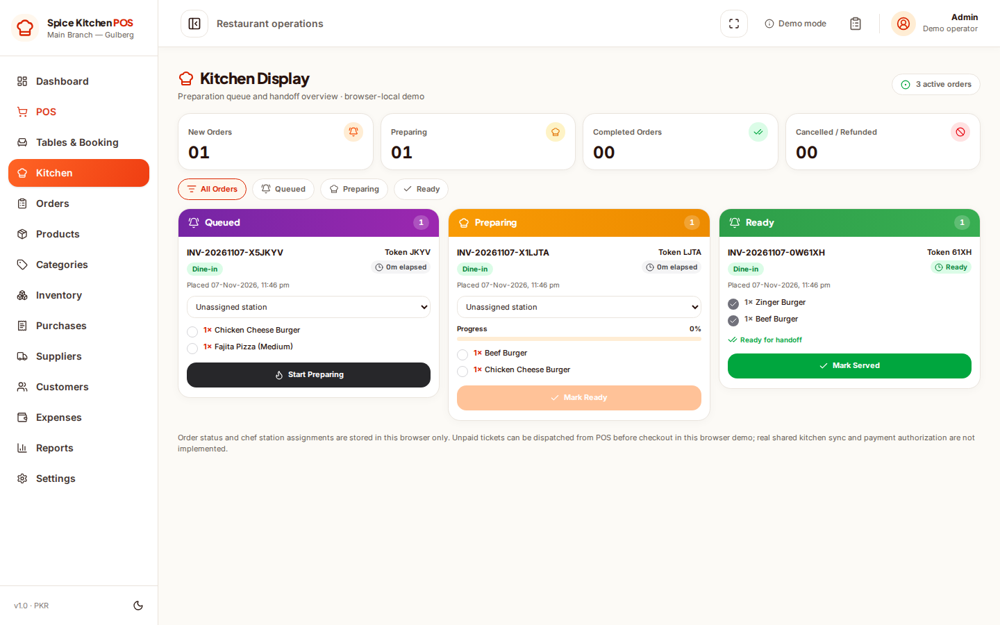
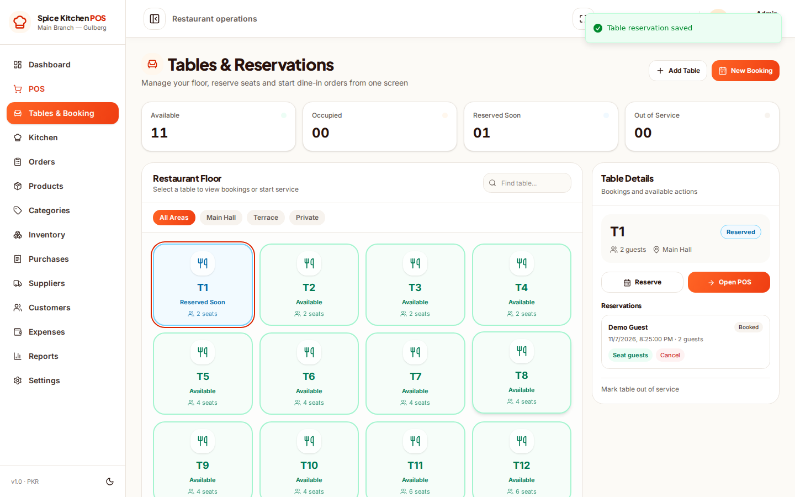
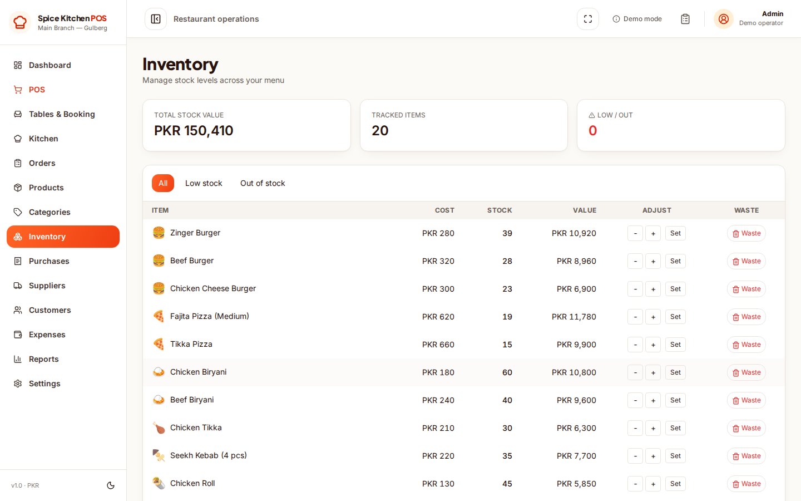
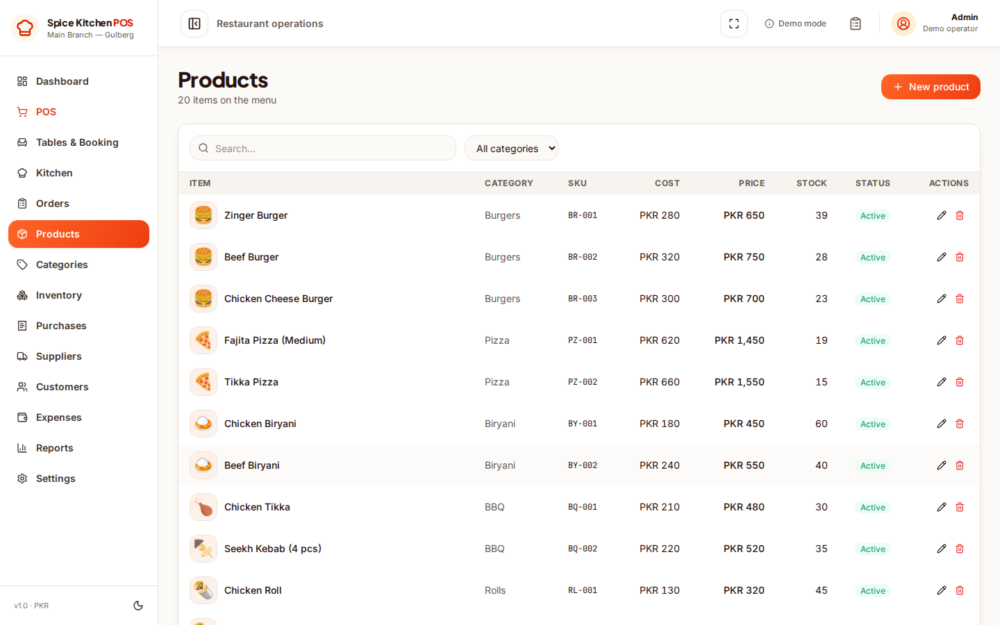
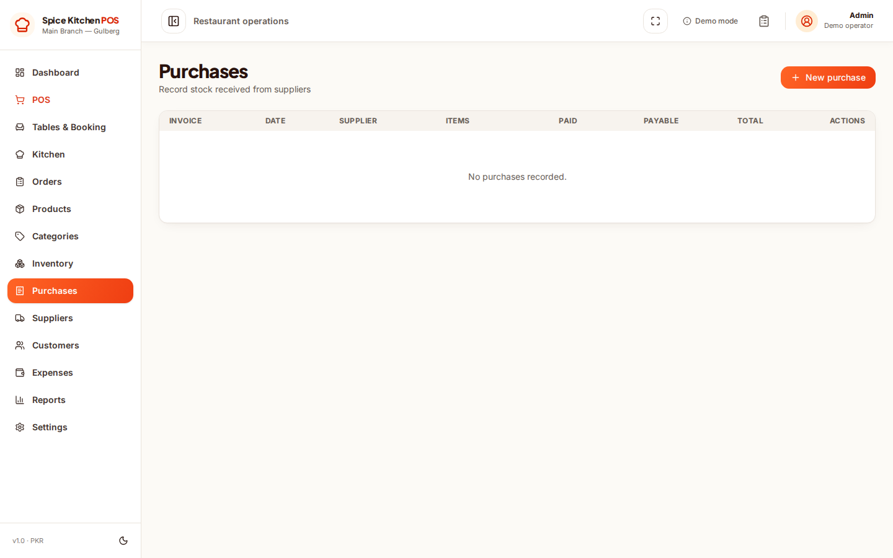
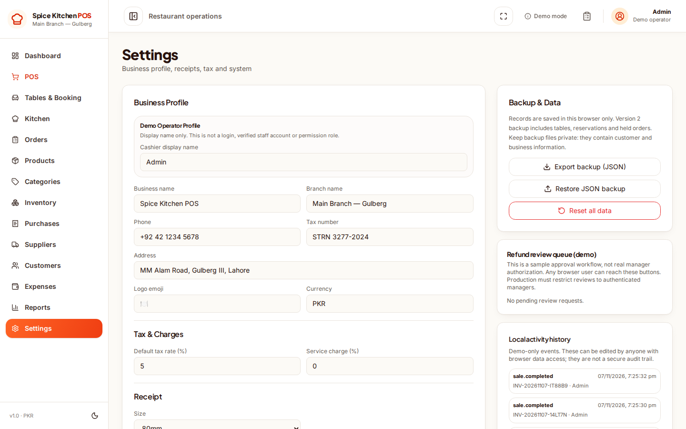
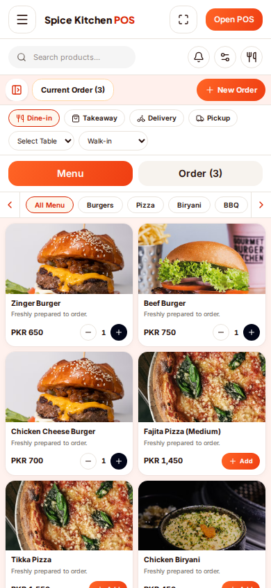
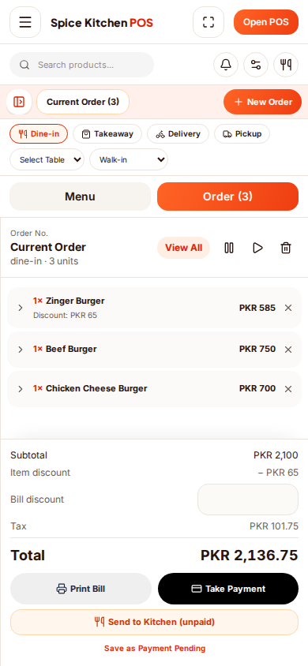

# Quick Dish Ops

**Open-source restaurant POS and operations demo.** Explore the code, run it locally, test the workflows and contribute improvements. This GitHub repository is the distribution point; **no public hosted demo is offered**.

[](https://github.com/khurramali42/quick-dish-ops/actions/workflows/build.yml)
[](LICENSE)

> **Demo software, not a production restaurant system.** All orders, customers, stock and settings are kept in the current browser's local storage. There is no account login, central database, device synchronization, real payment collection or audited ledger. Use **sample data only**, never actual personal/financial records. Clearing browser data may permanently erase changes.

## Application screenshots

Real Chromium screenshots captured from the **current built application**, using fictional local demo records. No design mockups or synthetic UI screenshots are substituted.

| Dashboard | Cashier / POS |
| --- | --- |
|  |  |

| Kitchen display | Tables and reservations |
| --- | --- |
|  |  |

| Orders | Inventory |
| --- | --- |
|  |  |

| Menu products | Supplier purchases |
| --- | --- |
|  |  |

| Settings | Mobile POS |
| --- | --- |
|  |  |



To regenerate these screenshots from the latest source, use the [Capture current application screenshots](.github/workflows/capture-screenshots.yml) workflow. Pull requests receive preview artifacts; after the workflow changes merge to `main`, its capture job can publish the updated PNG files. Only fictional browser-local data is used.

## What you can explore

- **POS:** menu and category browsing, item search, cart, discounts, tax, checkout simulation and receipt preview/printing with 58mm, 80mm or A4 options
- **Orders and kitchen:** order history, demo-only refund review and a local kitchen board with New → Preparing → Ready → Served; unpaid cart tickets can be sent to the local kitchen queue before checkout
- **Products and inventory:** categories, images, stock, ingredient recipes and reason-coded waste adjustments
- **Purchasing:** supplier records, incoming stock, partial supplier invoice settlements and expense entries
- **Customers and reports:** example customer records, basic sales summaries and financial snapshots
- **Local data:** JSON export, guarded restore and a browser-editable demo activity history through Settings

Some interfaces represent **simulated processes**, not integrations with payment terminals, accounting software, card networks or external kitchen displays.

## Run locally

**Requirements:** [Bun](https://bun.sh/) and a current, supported Node.js release. Git is required to clone the project.

```bash
git clone https://github.com/khurramali42/quick-dish-ops.git
cd quick-dish-ops
bun install --frozen-lockfile
bun run dev
```

Open the local URL shown in the terminal, usually **http://localhost:5173**. You do **not** need Supabase credentials, a payment key, or a hosted service to explore the demo.

### Tests and local build

```bash
bun test
bun run build
```

To run the built app locally, use `bun run start`. Browser-only functional tests are in `tests/`; GitHub Actions runs build, checkout and data-integrity checks. Manual screenshot and browser-test workflows are available for maintainers.

## Project map

| Path | Purpose |
| --- | --- |
| `src/routes/` | POS, dashboard, kitchen, inventory, orders, products and reports |
| `src/components/` | Shared UI, sidebar and printable receipt |
| `src/lib/store.ts` | Zustand state, browser persistence and demo operations |
| `src/lib/seed.ts` | Fictional restaurant catalog and starter data |
| `src/lib/types.ts` | Data models |
| `tests/` | Checkout, stock, kitchen, receipt and viewport checks |
| `docs/screenshots/` | Actual interface screenshots |

**Stack:** React, TypeScript, TanStack Start/Router, Vite, Tailwind CSS, Zustand, Bun and Nitro.

## Cross-module audit

See [cross-module integrity and settings audit (2026-11-07)](docs/cross-module-audit-2026-11-07.md) for current relationships, tested fixes, and the remaining production gaps.

## Public repository release

See [public release guide](docs/PUBLIC_RELEASE.md) for usable demo features, license/screenshot checks, and optional secure database architecture. **This project is public-source software, not a hosted multi-tenant restaurant service.**

## Before using this for a real restaurant

This code is a starting point for development, **not a commercially certified POS**. A real deployment would need secured authentication and roles, a central transactional database, reliable backups, audit trails, privacy controls, server-side inventory and payment validation, hardware/printer testing, multi-device concurrency and jurisdiction-specific tax review. Browser storage cannot safely replace those systems.

## Contributing and licensing

Contributions and bug reports are welcome. See [CONTRIBUTING.md](CONTRIBUTING.md), [SECURITY.md](SECURITY.md) and the GitHub issue template. Do not submit live customer data or credentials.

Distributed under the [MIT License](LICENSE), subject to third-party rights and [attribution notices](THIRD_PARTY_NOTICES.md). The project's historical commits preserve its original development provenance.

**This repository is shared for source-code review and local use. Public web hosting is intentionally not being promoted.**
