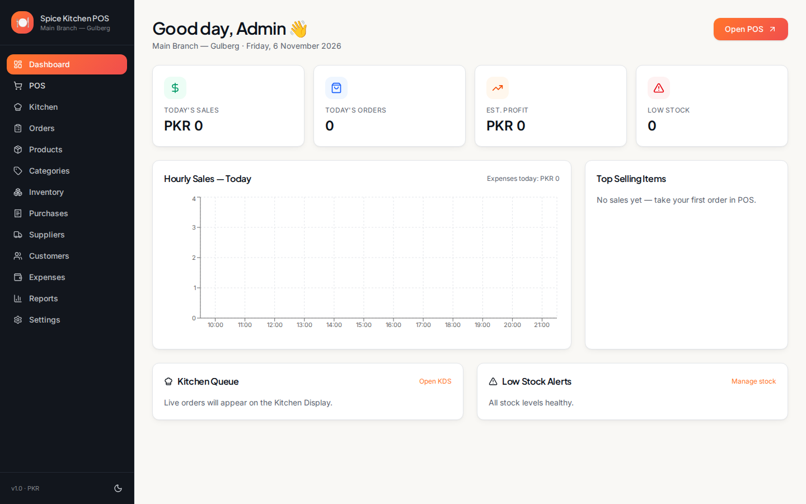
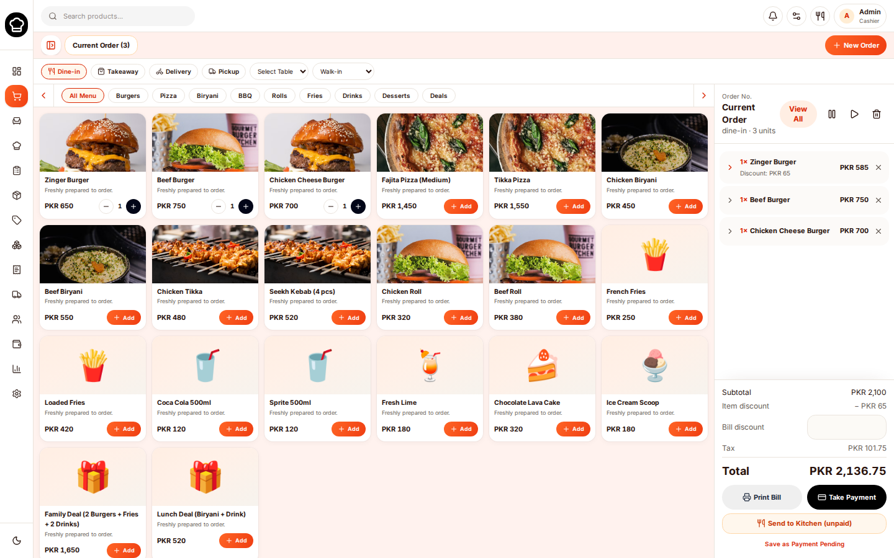
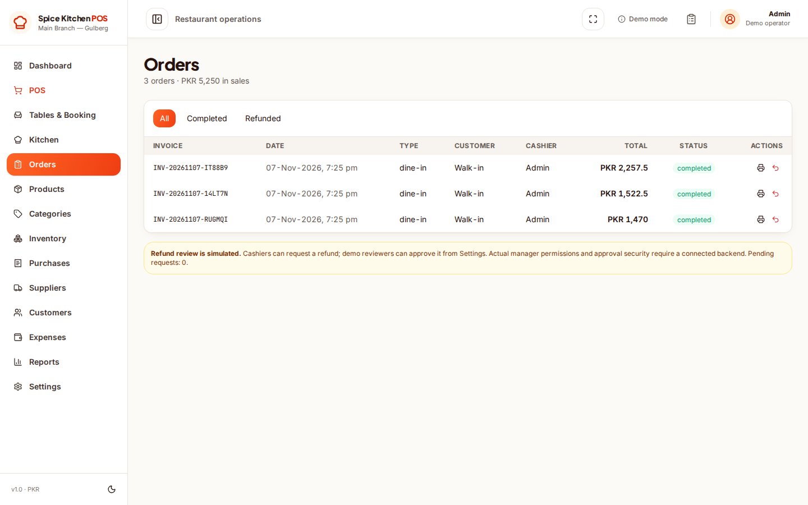

# Spice Kitchen POS

**A restaurant and cafe point-of-sale demo built with React, TypeScript, TanStack Start and Vite.**

[](https://github.com/khurramali42/quick-dish-ops/actions/workflows/build.yml)
[](LICENSE)

> **Demo/preview software, not a hosted multi-user POS service.** Records are stored in the current browser using Zustand localStorage. The app has no login system, shared database, server-side transactions, or real payment processing. **Use fictional data only.** Deleting browser storage can permanently remove records. See [Security](SECURITY.md).

## Application screenshots

These are **real screenshots captured from the running application**, not generated or redrawn mockups. They contain example/dummy restaurant information.

### Dashboard



### Point of sale



### Orders



## Current demo features

- Point-of-sale cart, discounts, checkout simulation, and printable receipts
- Restaurant orders and kitchen display
- Product catalog, categories and basic stock tracking
- Sample customers, suppliers, purchases and expense entries
- Local sales reports and configurable business profile
- Browser-local sample records and product image uploads

**Not implemented:** real card/Easypaisa/JazzCash transactions, shared staff accounts, live multi-device synchronization, server-authoritative financial records, audited refunds, automated backups, customer privacy controls or legal/tax compliance.

## Getting started

Prerequisites: a recent Node.js installation and [Bun](https://bun.sh/).

```bash
git clone https://github.com/khurramali42/quick-dish-ops.git
cd quick-dish-ops
bun install --frozen-lockfile
bun run dev
```

Open the address printed in the terminal, usually `http://localhost:5173`.

To run automated tests and create a build:

```bash
bun test
bun run build
```

To serve the production build for a **demo**:

```bash
bun run start
```

The sample catalog and fictional customer data are defined in `src/lib/seed.ts`. Your browser-local changes are separate from Git and **will not synchronize** to another browser or computer.

## Hosting the public demo

This repository supports deployment to Vercel using the TanStack Start + Nitro framework. It includes a `vercel.json` framework declaration and does **not** need a live database or payment API token.

Connect this repository to a Vercel project with framework preset **TanStack Start**, production branch `main`, and build command `bun run build`. The existing `nitro()` Vite plugin provides server rendering. Production deployment URLs should be verified by loading `/`, `/pos`, and `/orders`.

The hosted app is **still a demo**: the on-screen banner warns visitors not to enter real information; each browser has isolated localStorage and no cross-device sync.

## Project structure

| Folder | Purpose |
| --- | --- |
| `src/routes/` | Dashboard, POS, orders, kitchen, inventory, customers and reports |
| `src/components/` | Application layout and reusable UI |
| `src/lib/store.ts` | Browser-local demo state and sample checkout logic |
| `src/lib/seed.ts` | Example restaurant catalog and fictional profiles |
| `tests/` | POS integrity regression tests |
| `docs/screenshots/` | Genuine app screenshots |
| `.github/workflows/` | Build verification and optional browser screenshots |

## Safety, limitations and contributing

This project is intended for **learning, testing, demos and source-code review**. Even with checkout regression tests, browser storage is not appropriate for real financial records or personal data. Before a commercial rollout you would need secure authentication, persistent server storage, access restrictions, validated payments, conflict handling, backup/restore, audits, and legal review.

- [Security policy](SECURITY.md)
- [Contributing guide](CONTRIBUTING.md)
- [MIT License](LICENSE)
- [Third-party copyright and license notices](THIRD_PARTY_NOTICES.md)

Original screenshots remain available in the repository.

Historical commits document the development provenance and may include original tool/template references. Public Git history is intentionally preserved; release code and browser branding are independent. Device-framed promotional mockups have been deliberately removed.
